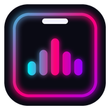
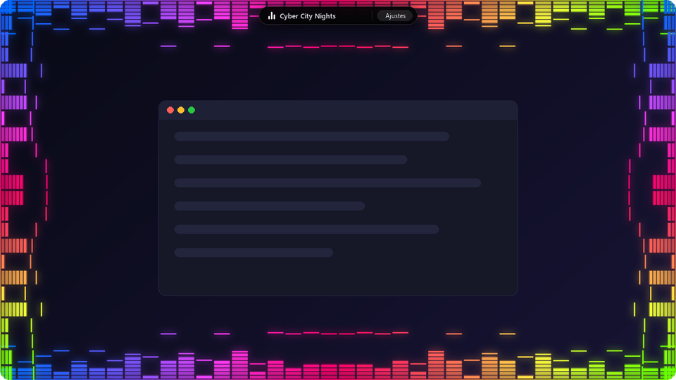
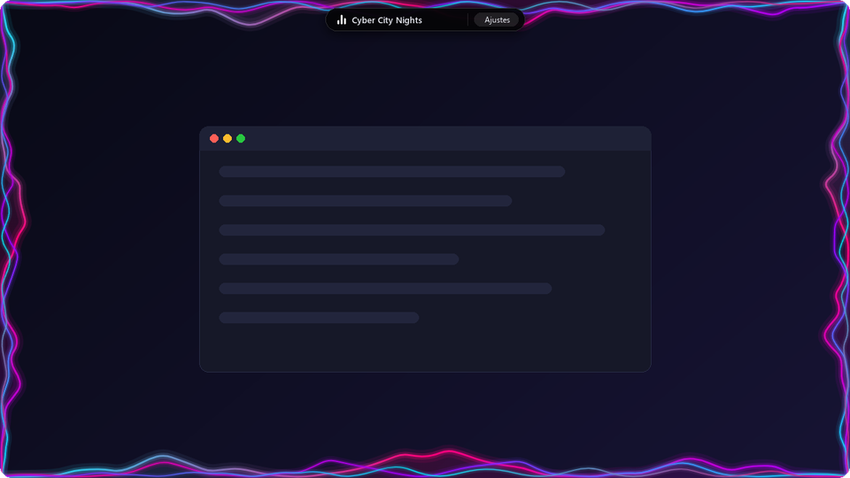
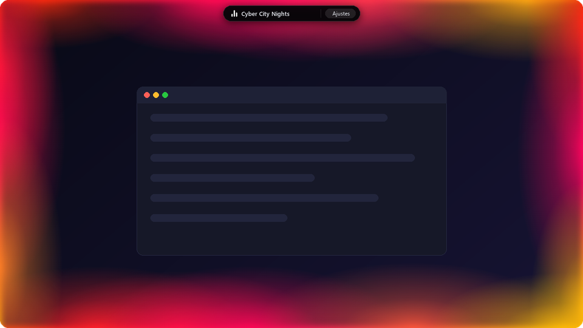
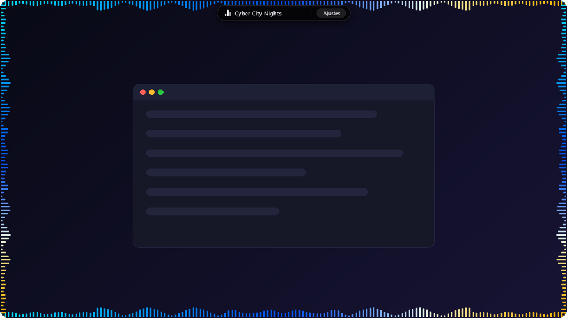
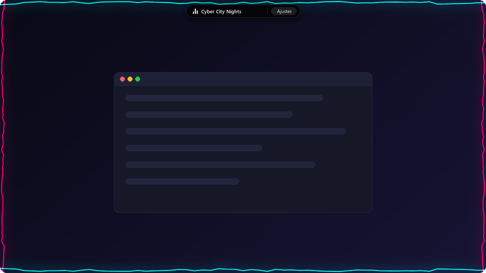

<div align="center">



# Edge Audio Visualizer

**Luces y efectos en los bordes de tu pantalla que bailan con la música de tu PC.**<br/>
Siempre visibles encima de todo, pero sin bloquear nunca el ratón.

<a href="https://github.com/amleman/edge-audio-visualizer/releases/latest">
  
</a>

<br/><br/>


<br/>



</div>

---

## 🎧 ¿Qué es?

**Edge Audio Visualizer** convierte los bordes de tu monitor en un espectáculo de luces que reacciona en tiempo real a todo lo que suena en tu computadora: Spotify, YouTube, juegos, Discord… lo que sea.

- 🖱️ **No estorba:** los efectos están encima de todo, pero tus clics pasan a través como si no existieran. Puedes trabajar, navegar o jugar normal.
- 🏝️ **Isla dinámica:** una pastilla elegante arriba al centro te muestra la canción que está sonando, con un mini ecualizador.
- 🎨 **Totalmente personalizable:** 5 estilos, más de 10 paletas de color, grosor, sensibilidad, brillo y qué bordes usar.
- ⚡ **Ligero:** captura el audio directo de Windows, sin instalar drivers ni cables virtuales.

---

## 🌈 Estilos de visualización

<table>
  <tr>
    <td width="50%" align="center">
      <br/>
      <b>🌊 Neon Waves</b><br/>
      <sub>Ondas neón en capas que se aceleran con cada golpe de bajo</sub>
    </td>
    <td width="50%" align="center">
      <br/>
      <b>☀️ Fluid Glow</b><br/>
      <sub>Luz ambiental que flota por los bordes y respira con la música</sub>
    </td>
  </tr>
  <tr>
    <td width="50%" align="center">
      <br/>
      <b>📊 Cyberpunk EQ</b><br/>
      <sub>Ecualizador tipo LED con picos flotantes</sub>
    </td>
    <td width="50%" align="center">
      <br/>
      <b>▫️ Minimal EQ</b><br/>
      <sub>Barritas finas y discretas, para quien prefiere algo sutil</sub>
    </td>
  </tr>
  <tr>
    <td colspan="2" align="center">
      <br/>
      <b>⚡ Electric Plasma</b><br/>
      <sub>Un rayo eléctrico recorre la pantalla y lanza chispas con los bajos</sub>
    </td>
  </tr>
</table>

**🎨 Paletas:** Dynamic Rainbow · Cyberpunk · Synthwave · Matrix · Electric Blue · RGB Puro · Rojo / Azul / Verde / Morado sólido · Blanco puro · Color de la carátula · Personalizada

---

## 🚀 Cómo instalarlo (en 1 minuto)

> No necesitas saber nada técnico ni instalar nada extra.

| Paso | Qué hacer |
|:---:|---|
| **1** | Entra en **[Descargas](https://github.com/amleman/edge-audio-visualizer/releases/latest)** y, en la sección **Assets**, haz clic en **`EdgeAudioVisualizer-...-win-x64.zip`** |
| **2** | Cuando termine, haz clic derecho en el `.zip` → **Extraer todo...** → **Extraer** |
| **3** | Abre la carpeta **Edge Audio Visualizer** y haz doble clic en **`EdgeAudioVisualizer.exe`** |
| **4** | Si aparece *"Windows protegió su PC"*: **Más información** → **Ejecutar de todas formas** |
| **5** | Pon música 🎶 ¡y listo! |

### 💡 Cómo se usa
- Haz clic en **Ajustes** en la isla de arriba para cambiar el estilo, colores, grosor y sensibilidad. El panel se puede arrastrar.
- Para cerrarlo: clic derecho en su icono junto al reloj de Windows → **Salir**.
- ¿Quieres un acceso directo? Clic derecho en `EdgeAudioVisualizer.exe` → **Mostrar más opciones** → **Enviar a** → **Escritorio (crear acceso directo)**.

---

## ❓ Preguntas frecuentes

<details>
<summary><b>¿Por qué Windows dice que "protegió mi PC"?</b></summary>
<br/>
Windows muestra ese aviso con cualquier programa nuevo que no tenga una firma digital de pago. No significa que tenga virus. El código es abierto y lo puedes revisar aquí mismo.
</details>

<details>
<summary><b>No se mueve nada / los bordes están quietos</b></summary>
<br/>
Asegúrate de que esté sonando algo y de que el volumen de Windows no esté en silencio. Si la música está muy baja, sube la <b>Sensibilidad</b> en Ajustes.
</details>

<details>
<summary><b>Me dice que falta "WebView2"</b></summary>
<br/>
Es un componente gratuito de Microsoft que ya viene en Windows 11 y casi todos los Windows 10. Si te falta, el programa te ofrece abrir la página de descarga: instálalo y vuelve a abrir el programa.
</details>

<details>
<summary><b>¿Afecta el rendimiento de mis juegos?</b></summary>
<br/>
El consumo es muy bajo: el audio se analiza en C# nativo y los efectos se dibujan con aceleración por GPU. Si quieres pausarlo un momento, pasa el ratón por la isla y usa el botón de encendido.
</details>

<details>
<summary><b>No veo la carpeta <code>dist</code> / ¿puedo borrarla?</b></summary>
<br/>
No la borres: ahí está la interfaz del programa. Mantén siempre juntos <code>EdgeAudioVisualizer.exe</code> y la carpeta <code>dist</code>.
</details>

---

## 🛠️ Para desarrolladores

<details>
<summary><b>Tecnologías y arquitectura</b></summary>
<br/>

| Capa | Tecnología |
|---|---|
| Host nativo | C# / .NET 10 + WPF + WebView2 |
| Captura de audio | NAudio · WASAPI Loopback (sin cables virtuales) |
| Análisis | FFT Radix-2 propia · 1024 puntos · ventana Hann · 64 bandas |
| Canción actual | Windows System Media Transport Controls (SMTC) |
| Interfaz | React 19 · TypeScript · Vite · Tailwind CSS v4 |
| Gráficos | Canvas 2D acelerado por GPU |

El programa usa dos ventanas: un **overlay** de pantalla completa 100% *click-through* (`WS_EX_TRANSPARENT`) que dibuja los bordes, y una ventana pequeña e **interactiva** con la isla dinámica y el panel de ajustes. Toda la arquitectura y el historial de problemas resueltos están en [`contexto.md`](contexto.md).
</details>

**Requisitos:** [Node.js](https://nodejs.org/) 20+ · [.NET 10 SDK](https://dotnet.microsoft.com/download) · Windows 10 (19041) o superior

```bash
npm install          # dependencias del frontend
npm run start:app    # compilar y abrir la app de escritorio
npm run dev          # probar la interfaz en el navegador (http://localhost:1420) con audio simulado
```

**Crear el paquete para compartir** (portable, incluye .NET):

```powershell
.\build-release.ps1
```

Genera `release\EdgeAudioVisualizer-v<versión>-win-x64.zip`. La versión sale de `<Version>` en `src-csharp/ScreenAudioVisualizer.csproj`.

```
src/                  Interfaz React (efectos en canvas, isla dinámica, panel de ajustes)
src-csharp/           Host WPF: ventanas, captura de audio, FFT, SMTC
docs/                 Imágenes del README
build-release.ps1     Empaquetado portable para compartir
LEEME.txt             Instrucciones incluidas dentro del .zip
contexto.md           Documentación técnica e historial de decisiones
```

---

<div align="center">
<sub>Hecho con 🎵 y mucho neón.</sub>
</div>
